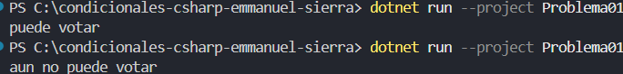

# Problema 1. Registro electoral

La Registraduría necesita un programa que reciba la edad de una persona e informe si puede votar (16 años o más en este ejercicio) o si todavía no puede hacerlo.

- Entrada: 16 o mas → Salida: `Puede votar`
- Entrada: 15 → Salida: `Aún no puede votar`

**Estructura elegida:** if-else

**Justificación:** si es 16 años o mas es verdadero, si es menos de 16 es falso.

**Evidencia:**
