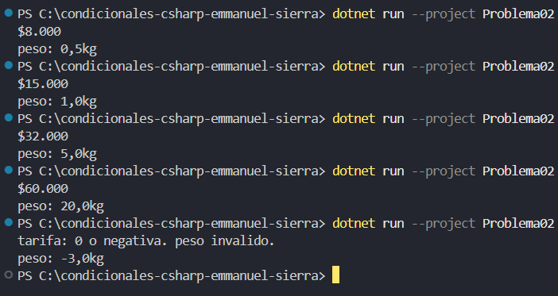

#  Problema 2. Tarifa de envío por peso

Una transportadora cobra según el peso del paquete en kilogramos y necesita guardar la tarifa en una variable para usarla después:

- Menos de 1 kg: $8.000
- De 1 kg a menos de 5 kg: $15.000
- De 5 kg a menos de 20 kg: $32.000
- 20 kg o más: $60.000
- Peso 0 o negativo: tarifa 0 y mensaje de peso inválido

Ejemplos: 0,5 → `$8.000` · 7 → `$32.000` · 25 → `$60.000` · -3 → `Peso inválido`

**Estructura elegida:** Múltiples condiciones con if - else if - else

**Justificación:** cada condicion es especifica del valor de entrada y la salida esperada. 

**Evidencia:**

