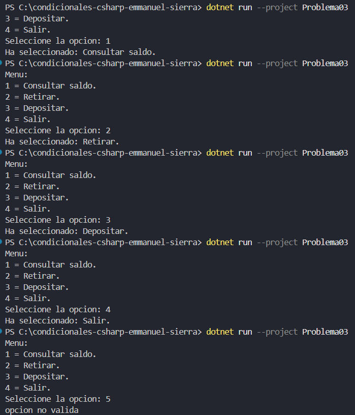

# Problema 3. Menú de cajero automático

El cajero muestra un menú: 1 = Consultar saldo, 2 = Retirar, 3 = Depositar, 4 = Salir. Según la opción digitada, el programa imprime la acción. Cualquier otro número muestra `Opción no válida`.

- Entrada: 2 → `Ha seleccionado: Retirar`
- Entrada: 9 → `Opción no válida`

**Estructura elegida:** swicth tradicional

**Justificación:** switch trabaja mejor que if con las expresiones contra varios casos.

**Evidencia:**

