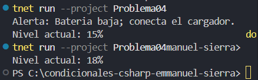

# Problema 4. Alerta de batería

Una app de celular revisa el nivel de batería. Si está por debajo del 15 %, muestra `Batería baja: conecte el cargador`. En cualquier caso, al final siempre muestra `Nivel actual: X %`.

- Entrada: 10 → dos líneas: la alerta y `Nivel actual: 10 %`
- Entrada: 80 → una línea: `Nivel actual: 80 %`

**Estructura elegida:** estructura if-else

**Justificación:** 1 es verdadero, si ninguna resulta true el codigo se ejecuta.

**Evidencia:**

