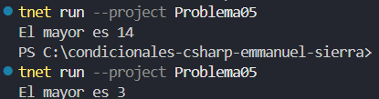

# Problema 5. El mayor de dos números

Dados dos números enteros, guarda en una variable `mayor` el más grande de los dos usando una sola línea de asignación, y luego imprímelo.

- Entrada: 14 y 9 → `El mayor es 14`
- Entrada: -2 y 3 → `El mayor es 3`

**Estructura elegida:** Operador ternario 

**Justificación:** facil de usar y leer para asignaciones condicionales simples.

**Evidencia:**

