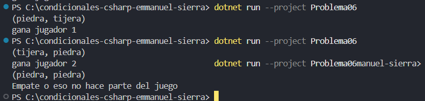

# Problema 6. Piedra, papel o tijera

Dos jugadores eligen “piedra”, “papel” o “tijera”. El programa recibe ambas jugadas y determina el resultado: piedra vence a tijera, tijera vence a papel, papel vence a piedra; si son iguales es empate.

- (“piedra”, “tijera”) → `Gana el jugador 1`
- (“piedra”, “papel”) → `Gana el jugador 2`
- (“papel”, “papel”) → `Empate`

**Estructura elegida:** Switch expressions (C# 8+)

**Justificación:** hace que el codigo sea mas legible y consico, funciona bien en valores basados en condiciones.

**Evidencia:**

