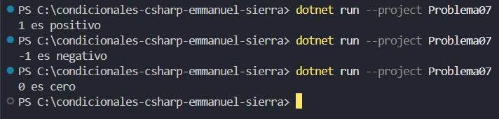

# Problema 7. Signo de un número

Lee un número entero e indica si es positivo, negativo o cero.

- 8 → `Positivo` · -5 → `Negativo` · 0 → `Cero`

**Estructura elegida:** estructura if - else if.

**Justificación:** por su legibilidad, flexibilidad y manejo de condiciones simples.

**Evidencia:**

