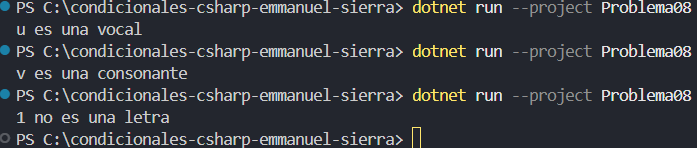

# Problema 8. Vocal o consonante

Lee una letra minúscula e indica si es vocal (a, e, i, o, u) o consonante. Si el carácter no es una letra del alfabeto, debe mostrar `No es una letra`.

- ‘e’ → `Es vocal` · ‘m’ → `Es consonante` · ‘7’ → `No es una letra`

**Estructura elegida:** Switch expressions (C# 8+)

**Justificación:** conciso y legible

**Evidencia:**

