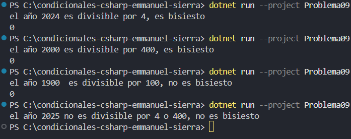

# Problema 9. Año bisiesto

Un año es bisiesto si es divisible entre 4 y no entre 100, o si es divisible entre 400. Determina si un año dado es bisiesto.

- 2024 → `Bisiesto` · 1900 → `No bisiesto` · 2000 → `Bisiesto`

**Estructura elegida:** estructura if - else

**Justificación:** Muestra la jerarquía de reglas en orden descendente con claridad paso a paso.

**Evidencia:**

