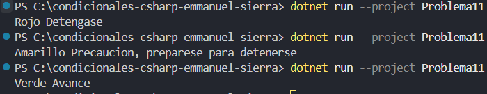

# Problema 11. Semáforo inteligente

Define un tipo con los estados posibles de un semáforo: Rojo, Amarillo y Verde. Según el estado actual, el programa imprime la instrucción para el conductor:

- Rojo → `Deténgase`
- Amarillo → `Precaución, prepárese para detenerse`
- Verde → `Avance`

**Estructura elegida:** estructura if-else if

**Justificación:** conciso y legible. excelente para desiciones basada en condiciones..

**Evidencia:**

