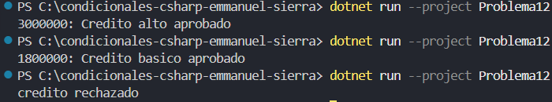

### Problema 12. Aprobación de crédito

Un banco estudia solicitudes de crédito. Primero verifica si el solicitante tiene empleo. Si no tiene, el crédito se rechaza. Si tiene empleo, revisa su ingreso mensual: si gana $2.500.000 o más se aprueba un crédito alto; si gana menos, se aprueba un crédito básico.

- Sin empleo → `Crédito rechazado`
- Con empleo, ingreso $3.000.000 → `Crédito alto aprobado`
- Con empleo, ingreso $1.800.000 → `Crédito básico aprobado`

**Estructura elegida:** estructura if - else if

**Justificación:** concisa y legible.

**Evidencia:**

