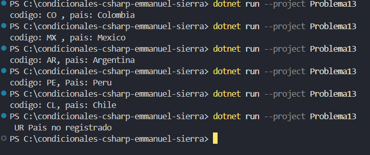

### Problema 13. Códigos de país

Un formulario web recibe un código de país de dos letras y debe guardar en una variable el nombre completo:

- “CO” → Colombia · “MX” → México · “AR” → Argentina · “PE” → Perú · “CL” → Chile
- Cualquier otro → `País no registrado`

**Estructura elegida:** Switch expressiones (C# 8+)

**Justificación:** concisa y legible.

**Evidencia:**

