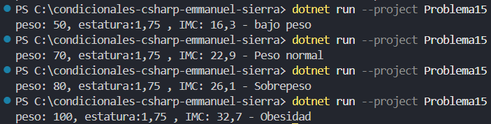

# Problema 15. Índice de masa corporal

Calcula el IMC con la fórmula peso / (estatura × estatura), peso en kg y estatura en metros, y clasifica el resultado. Se deben mostrar el valor del IMC con un decimal y la categoría:

- Menos de 18,5: Bajo peso
- De 18,5 a menos de 25: Peso normal
- De 25 a menos de 30: Sobrepeso
- 30 o más: Obesidad

Ejemplo: peso 70, estatura 1,75 → `IMC: 22,9 - Peso normal`

**Estructura elegida:** estructura if - else if

**Justificación:** conciso y legible.

**Evidencia:**

