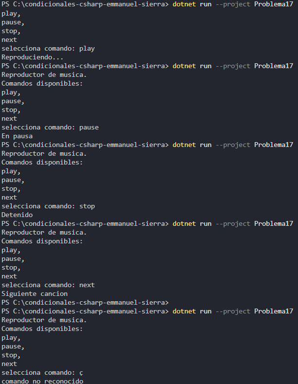

# Problema 17. Control de un reproductor

Un reproductor de música recibe comandos de texto: “play”, “pause”, “stop”, “next”. Cada comando imprime un mensaje distinto (`Reproduciendo...`, `En pausa`, `Detenido`, `Siguiente canción`). Un comando desconocido imprime `Comando no reconocido`.

**Estructura elegida:** switch tradicional 

**Justificación:** conciso y legible

**Evidencia:**

