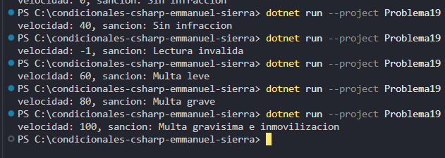

### Problema 19. Radar de velocidad

Un radar en una vía urbana con límite de 50 km/h clasifica la velocidad medida y guarda la sanción en una variable:

- Menos de 0: `Lectura inválida`
- De 0 a 50: `Sin infracción`
- Más de 50 hasta 70: `Multa leve`
- Más de 70 hasta 90: `Multa grave`
- Más de 90: `Multa gravísima e inmovilización`

Ejemplos: 45 → `Sin infracción` · 68 → `Multa leve` · 95 → `Multa gravísima e inmovilización`

**Estructura elegida:** switch expression (c# 8*)

**Justificación:** concisa y legible.

**Evidencia:**

