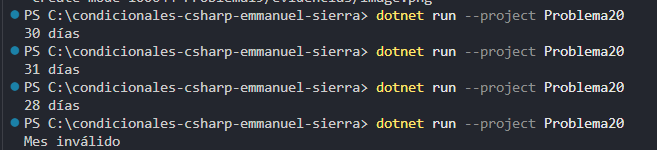

### Problema 20. Días de cada mes

Dado el número de un mes (1 a 12) de un año no bisiesto, imprime cuántos días tiene. Varios meses comparten la misma cantidad de días. Un número fuera de rango imprime `Mes inválido`.

- 4 → `30 días` · 2 → `28 días` · 12 → `31 días` · 13 → `Mes inválido`

**Estructura elegida:** Switch Expression (c# 8+)

**Justificación:** Agrupa los meses que comparten la misma cantidad de días en un solo brazo de evaluación.

**Evidencia:**

