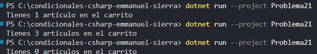

### Problema 21. Carrito de compras

La tienda virtual muestra cuántos artículos hay en el carrito. La palabra debe ir en singular si hay exactamente uno y en plural en cualquier otro caso. Construye el mensaje con una sola línea de asignación.

- 1 → `Tienes 1 artículo en el carrito`
- 3 → `Tienes 3 artículos en el carrito`
- 0 → `Tienes 0 artículos en el carrito`

**Estructura elegida:** Operador ternario

**Justificación:** conciso y legible.

**Evidencia:**

