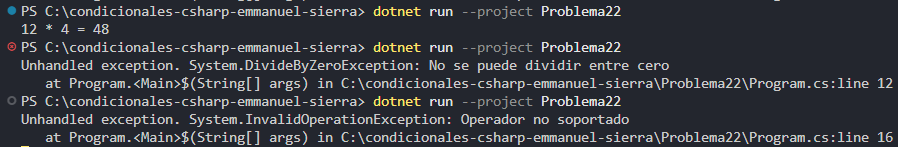

### Problema 22. Calculadora básica

Recibe dos números enteros y un operador (`+`, `-`, `*`, `/`) y guarda el resultado de la operación en una variable. Si se intenta dividir entre cero, el programa debe lanzar una excepción con el mensaje `No se puede dividir entre cero`. Si el operador no es válido, debe lanzar una excepción con el mensaje `Operador no soportado`.

- 12, 4, ‘*’ → `12 * 4 = 48`
- 10, 0, ‘/’ → excepción `No se puede dividir entre cero`
- 5, 2, ‘%’ → excepción `Operador no soportado`

**Estructura elegida:** Sentencia switch tradicional con validación if

**Justificación:** concisa y legible.

**Evidencia:**

