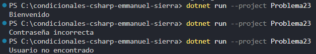

### Problema 23. Inicio de sesión

Un sistema valida el acceso en dos pasos. Primero verifica que el usuario exista (el único usuario registrado es “aprendiz”). Si no existe, muestra `Usuario no encontrado`. Si existe, verifica la contraseña (“Sena2026”): si es correcta muestra `Bienvenido`; si no, muestra `Contraseña incorrecta`. Cada error debe tener su propio mensaje.

**Estructura elegida:** Estructura condicional en cadena if - else if - else.

**Justificación:** Concisa y legible.

**Evidencia:**

