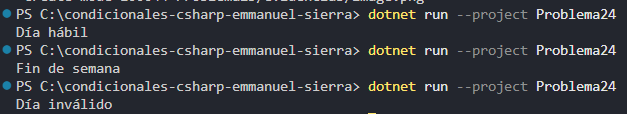

### Problema 24. ¿Día hábil?

Dado el número de un día de la semana (1 = lunes … 7 = domingo), guarda en una variable si es `Día hábil` (lunes a viernes) o `Fin de semana` (sábado y domingo). Cualquier otro número es `Día inválido`.

- 3 → `Día hábil` · 7 → `Fin de semana` · 0 → `Día inválido`

**Estructura elegida:** Estructura condicional if - else if - else

**Justificación:** concisa y legible.

**Evidencia:**

