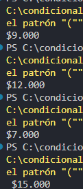

### Problema 27. Taquilla de cine

El precio de la boleta depende de dos datos a la vez: el día (texto: “lunes” … “domingo”) y si la persona es estudiante (sí/no).

- Los martes la boleta cuesta $7.000 para todos.
- De lunes a viernes (excepto martes), un estudiante paga $9.000 y un no estudiante $12.000.
- Sábado y domingo cuesta $15.000 para todos.

Ejemplos: (“martes”, no) → `$7.000` · (“jueves”, sí) → `$9.000` · (“jueves”, no) → `$12.000` · (“sábado”, sí) → `$15.000`

**Estructura elegida:** switch expression

**Justificación:** concisa y legible

**Evidencia:**

