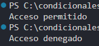

### Problema 29. Control de acceso a la sede

El torniquete de la sede recibe dos datos: el rol de la persona (“admin”, “instructor”, “aprendiz”) y la hora de llegada (0 a 23). Las reglas son:

- “admin” puede entrar a cualquier hora.
- “instructor” puede entrar de 6 a 21 horas.
- “aprendiz” puede entrar de 6 a 18 horas.
- Cualquier otro caso: acceso denegado.

Ejemplos: (“admin”, 2) → `Acceso permitido` · (“aprendiz”, 19) → `Acceso denegado` · (“instructor”, 20) → `Acceso permitido`

**Estructura elegida:** cadena if-else if- if

**Justificación:** concisa y legible.

**Evidencia:**

